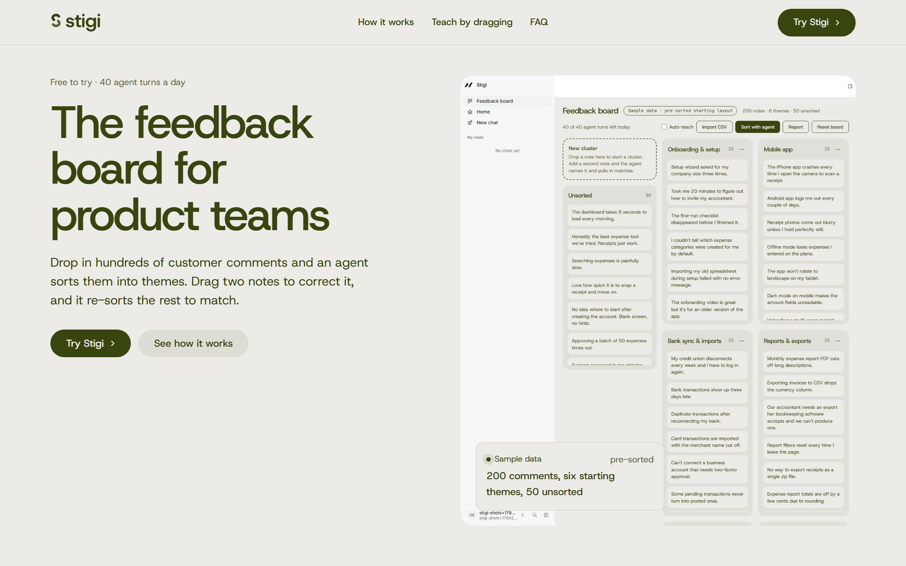
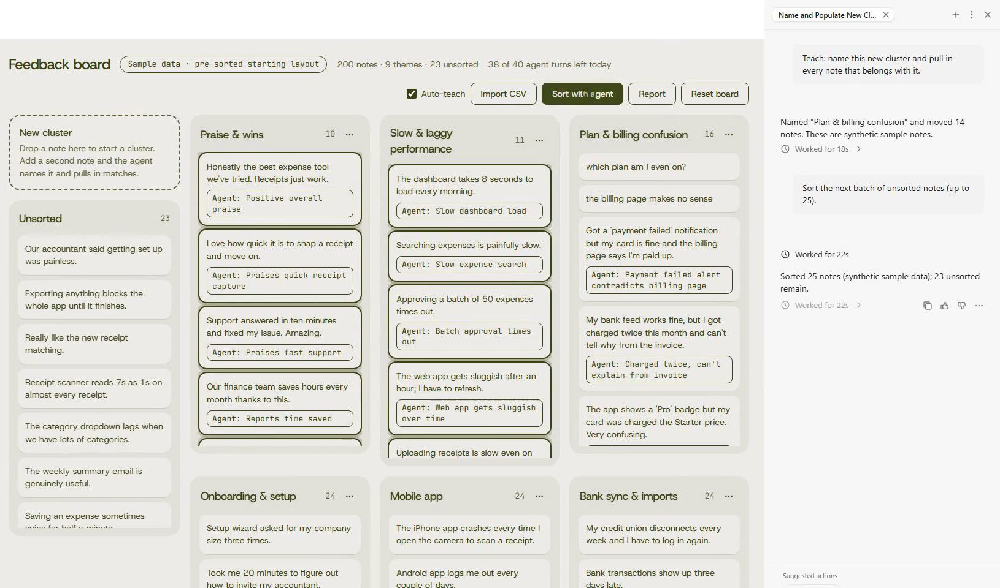
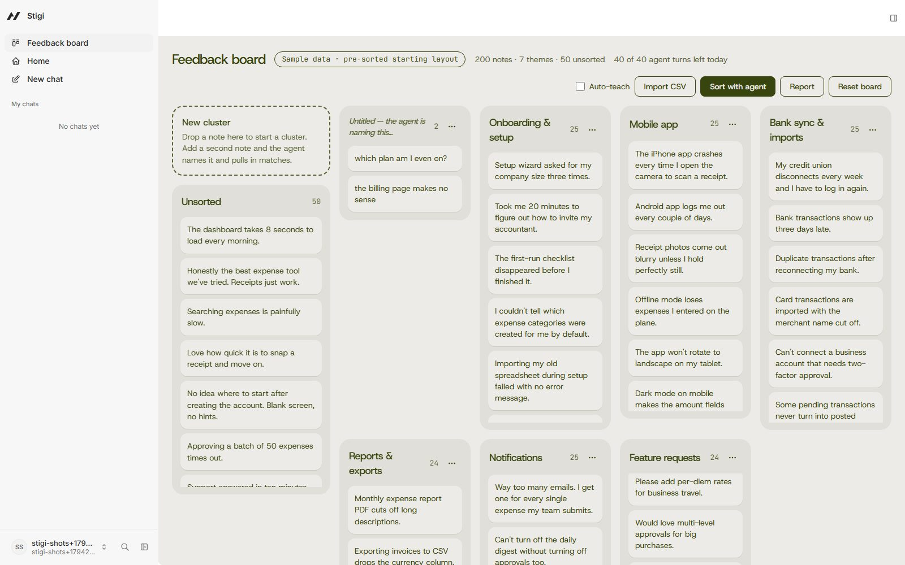

<!-- readme-schema: R1-web-app v1 -->
# Stigi

A feedback board where an agent sorts customer comments into themes, you drag two notes to teach it, and it re-sorts the rest.



*The hero of the live app at https://stigi.suitz.xyz.*

## Demo

- Demo video (public, hosted on Clips; an uploaded cut of a real run of the live app): https://clips.agent-native.com/share/xcUFzqFhqqei
- Live app (sign up with any email and password): https://stigi.suitz.xyz
- Slides: https://stigi-slides.vercel.app ([PDF](https://stigi-slides.vercel.app/stigi-slides.pdf))
- Screenshots: the hero above, the payoff, and the teach moment (sample data):



*A recorded run on the live app: the agent named the cluster and moved 14 notes in, each with a one-line reason.*



*The teach moment: two dragged notes wait for the agent to name their cluster.*

The live app and the video use **sample data**: 200 synthetic comments for a fictional expenses app, labeled as
sample in the app and loaded as a deliberately imperfect pre-sorted starting layout.

## What it does

Product teams sit on hundreds of raw customer comments, and turning them into themes is hours of sticky-note
work. One-shot AI summaries can't be corrected: fix one grouping by hand and the rest of the pile doesn't follow.
Stigi makes the correction the instruction. Drag two notes into a new cluster and the agent names the theme, pulls
every matching note in from across the board, and shows a one-line reason on each note it moved. "Sort with agent"
files the unsorted pile in small batches, and the agent writes a ranked insight report you edit and export as
Markdown.

## Quickstart

Needs Node.js 22.22 or later and pnpm 10.

```bash
pnpm install
cp .env.example .env    # then add your OpenRouter key to .env as OPENROUTER_API_KEY (never commit it)
pnpm dev                # http://localhost:8080, choose "Continue as local dev"
```

Open **Feedback board**, click **Load sample data (200 notes)**, drag "which plan am I even on?" onto **New
cluster**, then drag "the billing page makes no sense" onto the new cluster. The agent names it and the matching
notes glide in from the other clusters. The agent needs the key; the board, drag-and-drop and report editor work
without one.

## Built at Agent-Native Hackathon (Builder.io)

- Event: the Agent-Native Hackathon by Builder.io (final submission deadline 2026-11-09 23:59 PT).
- Recognition categories aimed at: Best Overall App, Best Use of Agent-Native, Best Productivity App (the event has
  no tracks; one weighted rubric ranks every entry).
- Team: a solo builder (GitHub `Dotman-Bei`) working with Claude Code.
- Built during the event (2026-11-09 to 2026-11-10): every Stigi action, the board UI, the agent instructions and
  skills, the database schema, the per-account daily agent-turn cap, the Vercel + Neon deployment setup, the test
  suites, the public landing page, the Stigi logo kit (`docs/brand/logo/`), the demo video project (`demo/`) and the slides.
- Pre-existing work built on: the Agent-Native `chat` template (`@agent-native/core` 0.226.0) and its
  `@agent-native/toolkit` components (app shell, agent sidebar), plus design tokens and motion rules from the
  `design-taste-frontend` kit.
- Third-party assets: the fonts Host Grotesk and JetBrains Mono (SIL Open Font License 1.1); Tabler Icons (MIT) from
  the template; Lucide icons (ISC) in the landing diagram; the photograph "Tabel day 1" by Jan Kahánek (CC0, Wikimedia
  Commons) in the landing page, credited in its footer. The logo is original geometry plus Host Grotesk outlines.
  The landing page's product pictures are real screenshots of this app with the labelled sample data.

## How it works

Stigi is an Agent-Native app: the board UI and the agent share one set of `defineAction()` actions, one Postgres
database and one app-state.

- **One action layer.** `import-notes`, `list-notes`, `create-cluster`, `rename-cluster`, `move-notes`,
  `merge-clusters`, `delete-cluster`, `get-board-digest`, `save-report` and `view-screen` are the only way the board
  changes. A drag in the UI calls `move-notes`; the agent calls the same `move-notes` as a tool. When the agent
  moves a note into a cluster it must give a one-line reason, or the action refuses; an agent call is also capped at
  25 moves.
- **Teach by dragging.** When a cluster you made reaches two notes, the UI hands the request to the agent with the
  cluster id and the seed notes as hidden context, and confirms the agent chat received it (it opens the panel and
  retries once, or shows an error instead of hanging). The agent follows its `teach-cluster` skill: name the theme,
  list the notes outside the cluster, and move the clear matches in one call.
- **Shared app-state.** Your note selection is written to the `selection` app-state key and read by the agent's
  `view-screen`; the agent opens the report pane with a `navigate` command.
- **Live board.** Each agent tool call refreshes the board's queries, and the board also polls every 750 ms while
  the agent works, so moved notes glide into place even on serverless hosting.
- **Short agent turns.** Every agent turn is one small batch (teach: up to 20 moves; sort: up to 25 notes), so it
  finishes inside the framework's 40-second hosted turn budget. Vercel functions run with `maxDuration: 60`.
- **Safe public demo.** Sign-in is required, each account sees only its own board, the OpenRouter key stays on the
  server, and each account gets 40 agent turns per day.

## Tech stack

- Agent-Native framework `@agent-native/core` 0.226.0 (React 19, React Router 8, Nitro 3, Drizzle ORM)
- Postgres: PGlite locally, Neon in production
- Agent: OpenRouter through the framework's `ai-sdk:openrouter` engine, model `anthropic/claude-sonnet-5.5`
- UI: `@dnd-kit/core` drag-and-drop, `motion` layout animation, Host Grotesk and JetBrains Mono
- Tests: Vitest (actions on in-memory PGlite, components with Testing Library; 123 passing at submission) and
  Playwright end-to-end, including runs against the deployed app
- Hosting: Vercel (`NITRO_PRESET=vercel`) with Neon Postgres

## Run locally

```bash
pnpm install
pnpm dev           # http://localhost:8080
pnpm test          # unit and component tests (no API key needed)
pnpm typecheck
pnpm e2e           # Playwright against the local dev server (the live specs need OPENROUTER_API_KEY)
```

Deploy (Vercel + Neon). Set the production variables below in Vercel first; on Windows the build output needs
`scripts/fix-vercel-output.mjs`, which replaces absolute symlinks that the Vercel upload cannot follow:

```bash
CONTEXT=production pnpm migrate:production     # with DATABASE_URL exported; refuses a local database
NITRO_PRESET=vercel AGENT_NATIVE_VERCEL_CRON_SCHEDULE="0 9 * * *" pnpm build
node scripts/fix-vercel-output.mjs
node scripts/check-vercel-output.mjs
pnpm exec vercel deploy --prebuilt --prod
pnpm e2e:deployed                              # with STIGI_E2E_TARGET set by the script
```

| Variable | Purpose |
|---|---|
| `OPENROUTER_API_KEY` | OpenRouter key for the agent (secret: `.env` only, never committed) |
| `AGENT_ENGINE` | `ai-sdk:openrouter` |
| `AGENT_MODEL` | `anthropic/claude-sonnet-5.5` (fallback: `anthropic/claude-haiku-5.5`) |
| `AGENT_ENGINE_PREFER_BYO_KEY` | `1`: use your own key rather than a managed gateway |
| `STIGI_DAILY_AGENT_TURNS` | Agent turns per account per day (default 40) |
| `DATABASE_URL` | Production only: Neon pooled connection string (leave unset locally to use PGlite) |
| `BETTER_AUTH_SECRET` | Production only: stable session-signing secret (32+ characters) |
| `CRON_SECRET` | Production only: secret for the daily cron route |
| `AGENT_NATIVE_RELEASE_MIGRATIONS` | Production only: `1`, so migrations run at release and not on every request |
| `AUTH_REQUIRE_EMAIL_VERIFICATION` | Production only: `0`, so password sign-up works without an email provider |
| `GOOGLE_GENERATIVE_AI_API_KEY` | Optional: only for the dormant Gemini alternative (`AGENT_ENGINE=ai-sdk:google`) |

## Roadmap

- Undo the agent's last batch.
- Drag several selected notes at once.
- Pick the comment column when a CSV has no recognised header.
- Known limits: corrections steer the current board only (Stigi does not learn across sessions); the demo uses
  synthetic sample data; the agent depends on a funded OpenRouter key, so a public instance stops answering agent
  turns when that key's credit is used up (the board itself keeps working).

## License

MIT for Stigi's own code and docs, see [LICENSE](LICENSE). Third-party material keeps its own terms and is not
relicensed by this repository: the `design-taste-frontend` kit under `docs/design/` is included for reference only,
and the fonts, icons and photograph listed under "Built at Agent-Native Hackathon" carry their own licenses.
